# RackWare RMM 7.7 – Getting Started Guide

**Deploy RMM | Migrate your first server | Protect it with Disaster Recovery**

Version 1.2 · November 2026 · For RackWare Management Module (RMM) 7.7

*Screens captured from a live RMM 7.7.6.5 deployment on Oracle Cloud Infrastructure (OCI). Names and IP addresses shown are examples.*

<!-- end-cover -->


## About this guide

This guide takes you, step by step, from zero to a working RackWare environment. No prior RackWare experience is needed. When you finish you will have:

- **Deployed the RackWare Management Module (RMM)** – the appliance that does all the work.
- **Migrated a first server** to the cloud, with RMM creating the target virtual machine for you.
- **Protected a server with Disaster Recovery (DR)** and run a non-disruptive DR test.

Plan about **1-2 hours** for the first server (most of it is waiting for cloud resources). Every screenshot was taken from a real RMM 7.7 running on OCI, migrating and protecting a Rocky Linux server (named **GCP-RockyLinux-SRC**) from Google Cloud to an OCI instance (named **rocky-guide-demo**).

> [!NOTE]
> Look out for the highlighted boxes: **Note** = background information, **Tip** = helpful advice or the result you should see, **Warning** = important, read before continuing.

Need help at any point? Contact RackWare Support at **support@rackwareinc.com** (phone +1 844 797 8776) or your RackWare partner. License questions: **licensing@rackwareinc.com**.


## 1. How RackWare RMM works

RackWare RMM is a single Linux appliance (a virtual machine) that you place in your network, usually in the **target** cloud or data center. From there it:

1. **Discovers** your source servers over SSH (physical, VMware, Hyper-V, Nutanix, AWS, Azure, GCP, OCI… any of them).
2. **Creates the target VM** for you through the cloud API (called **auto-provisioning**), or uses a VM you created.
3. **Copies the whole server** – operating system, applications, data and settings – while the source keeps running.
4. **Keeps the copy up to date** with fast delta syncs, so the final cutover (migration) or recovery (DR) takes minutes.

   | Source servers |   | RackWare RMM |   | Target |
   |---|---|---|---|---|
   | Linux and Windows servers on any platform (on-prem or cloud) | → | Linux appliance with web console. Talks SSH to sources and targets, API to the cloud | → | OCI, OCVS, Compute Cloud@Customer, PCA, OLVM, Azure, GCP, AWS, IBM VPC, VMware, Nutanix… |


### Agentless by design

- **Linux:** nothing to install. RMM connects with an SSH key using a normal user with sudo rights.
- **Windows:** install one small service, **RWSSHD** (an SSH service supplied by your RMM), on each server.
- **Targets:** a VM that RMM auto-provisions needs no preparation. If you use a VM you created yourself as the target, prepare it for SSH access exactly like a source (section 7).


### Two ways to copy a server

| Sync type | How the data flows | Use it for |
|---|---|---|
| Direct Sync | Source → target (through RMM). No copy is kept on RMM. | Migrations. Simple and needs no extra storage. |
| Stage 1 and Stage 2 | Stage 1: source → image stored on the RMM (ZFS pool). Stage 2: image → target. | Disaster Recovery and backup. The image on RMM gives you recovery points and fast re-syncs. |


### Key terms used in the console

| Term | Meaning |
|---|---|
| Host (source) | A server you want to migrate or protect (Hosts → Source). |
| Target | The VM that receives the copy. RMM can create it (Autoprovision) or use one registered under Hosts → Target. |
| Cloud User | The credentials RMM uses to create VMs in your cloud (for OCI: API key or instance principal). |
| Wave | A group of hosts migrated together. You start a wave with the Play button. |
| Image / ZFS pool | The copy of a host stored on the RMM by Stage 1 syncs, kept in a ZFS storage pool on the RMM's extra DR disk. |
| DR Policy | A schedule that keeps hosts replicated for DR. Its interval defines your RPO. |
| Failover Group | Hosts that fail over together, in a boot order (tiers), e.g. database first, then app, then web. |


## 2. Before you start – checklist

Go through this list before you begin. Most problems in first projects come from a closed firewall port or a missing permission. The RMM also shows a built-in checklist on its Dashboard (section 5.2).


### 2.1 The RMM virtual machine

| Item | Recommendation |
|---|---|
| Size | Recommended: 4 OCPU / 32 GB on OCI (1 OCPU = 2 vCPU), or 4-8 vCPU / 32 GB elsewhere. Add 1 OCPU for every 5 servers you want to sync at the same time. The Marketplace listing's technical minimum (1 OCPU / 16 GB) is only for small evaluations; the lab RMM in the screenshots has 8 vCPU / 23 GB. |
| OS disk | 100-150 GB. The OCI Marketplace default boot volume is enough to start. |
| DR disk (DR only) | One extra, empty block volume at least as large as the used space of all servers you will protect. RMM turns it into its ZFS image pool. Not needed for migrations. |
| Operating system | Included in the OCI Marketplace image. For a manual install: Oracle Linux, Rocky Linux or RHEL 8.x (8.10 recommended). |
| Firmware | Secure Boot off (on OCI: leave "Shielded instance" disabled). |
| Location | Ideally in the target cloud/region, in a subnet that can reach the sources and the target subnet. |


### 2.2 Network ports

Open these ports in **both** the operating-system firewall and the cloud firewall (OCI Security List / NSG, AWS Security Group, Azure NSG, GCP VPC firewall rule) of each side.

| From | To | Port | Why |
|---|---|---|---|
| Your PC | RMM | TCP 443 (and 22) | Web console (HTTPS) and SSH administration |
| RMM | Source servers | TCP 22 | Discovery and data sync (SSH). Allow the RMM public or private IP in the source cloud firewall. |
| RMM | Target subnet | TCP 22 (+ 445 for Windows) | Writing the copy to the target VM |
| RMM | Cloud API | TCP 443 outbound | Creating target VMs (auto-provisioning) |
| RMM | Internet | 80/443 | Only during installation or upgrade (packages) |


### 2.3 License and access

- **License:** the OCI Marketplace **Paid** listing is licensed automatically. With the **BYOL** listing you can obtain **2 free trial licenses valid for 30 days** (for a POC), or use your purchased licenses. In both cases – and for manual installs – you request the license file as described in section 5.1.
- **How licenses count:** one license per source server, used the first time any operation touches that server. Repeating syncs of the same server uses nothing more. The Dashboard shows what is left, e.g. "8/10 remain".
- **Cloud access:** an OCI user or dynamic group allowed to create instances and volumes and to use the networks in the target compartment (section 6).
- **Source access:** a Linux user with sudo rights, or local administrator on Windows to install RWSSHD (section 7).


## 3. Deploy RMM from the OCI Marketplace (recommended)

The fastest way to get RMM is the ready-made image on the Oracle Cloud Marketplace. It takes about 15 minutes.


#### Step 1 – Find RackWare in the Marketplace

1. Log in to the OCI Console and select the **region** where you want to run RMM (top right).
2. Open the menu and go to **Marketplace → All Applications**. Type **RackWare** in the search box.

   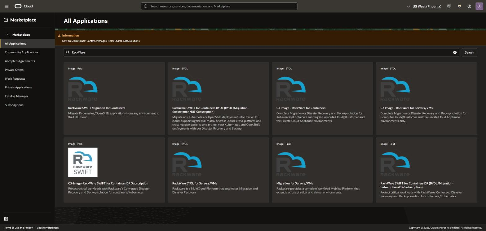

   *Figure 1 – RackWare listings in the OCI Marketplace*

   | Listing | Choose it when |
   |---|---|
   | RackWare BYOL for Servers/VMs | You bought RackWare licenses (directly or from a partner) or are running a trial / POC. |
   | Migration for Servers/VMs (Paid) | You want to pay through your Oracle Universal Credits. License is included. |
   | C3 Image - RackWare for Servers/VMs | You are deploying on Compute Cloud@Customer or Private Cloud Appliance. |
   | Listings with "SWIFT" or "Containers" in the name | Only for Kubernetes / OpenShift containers (separate product, not covered by this guide). |


#### Step 2 – Launch the instance

Open the listing and click **Launch Instance** (top right). The listing page also links to the official user guides.

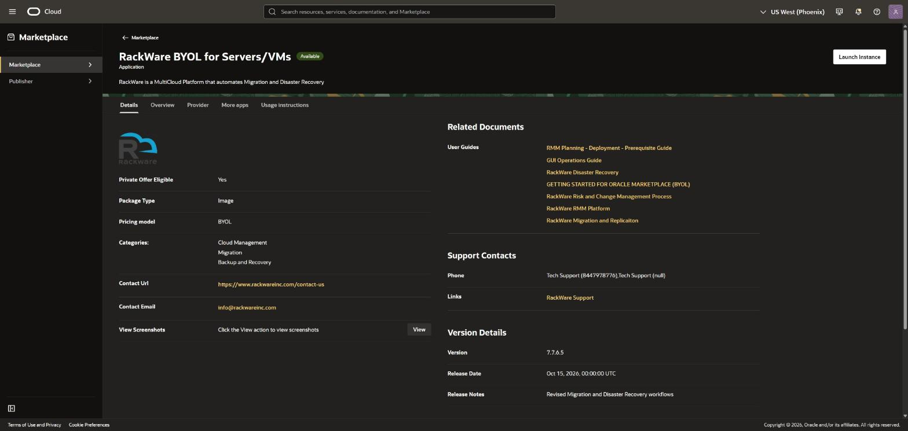

*Figure 2 – RackWare BYOL for Servers/VMs listing (version 7.7.6.5)*

Select the **compartment**, keep the default (latest) **version**, read the terms and **tick** "I have reviewed and accept the Oracle Terms of Use and Publisher terms and conditions". Then click **Launch Instance**.

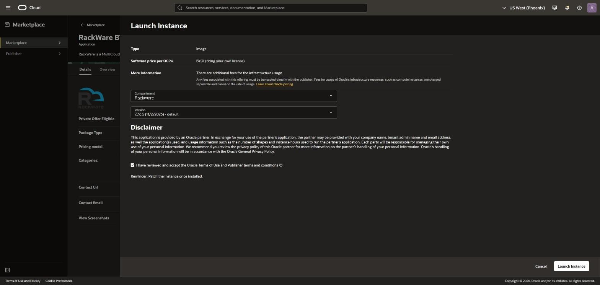

*Figure 3 – Choose compartment and version, accept the terms, then Launch Instance*


#### Step 3 – Name, placement and shape

The **Create compute instance** form has five sections (Basic information → Security → Networking → Storage → Review). Click **Next** at the bottom right to move from one section to the next.

1. Give the instance a clear **name**, for example `rackware-rmm`, and check **Create in compartment**. Any **availability domain** with capacity for the shape is fine.
2. Under **Shape**, click **Change shape**, choose **VM.Standard.E5.Flex**, expand it and set **4 OCPU and 32 GB** memory. Click **Select shape**.

   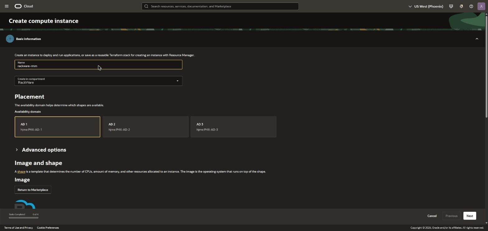

   *Figure 4 – Instance name and placement*

   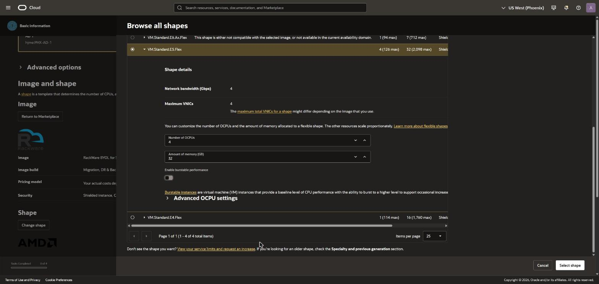

   *Figure 5 – Recommended shape: 4 OCPU / 32 GB*


#### Step 4 – Security

Leave **Shielded instance** and **Confidential computing** disabled. RMM needs Secure Boot turned off.

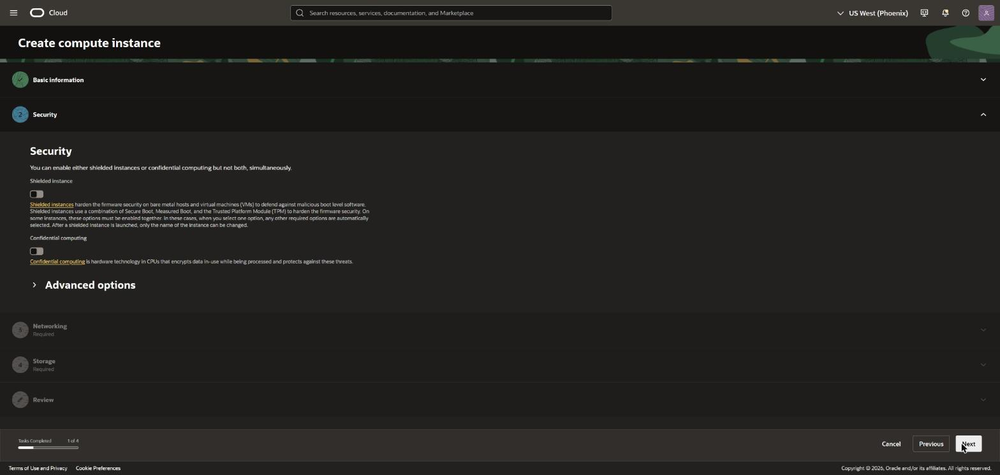

*Figure 6 – Keep Shielded instance disabled*


#### Step 5 – Networking and SSH key

1. Select a **VCN and subnet** from which RMM can reach your source servers (VPN/FastConnect or internet) and the subnet where target VMs will be created.
2. Enable **Automatically assign public IPv4 address** if you will open the web console over the internet. Otherwise use the private IP through VPN.
3. Under **Add SSH keys**, generate or upload a key pair and **save the private key** – you need it to log in to the RMM as user `opc`.

   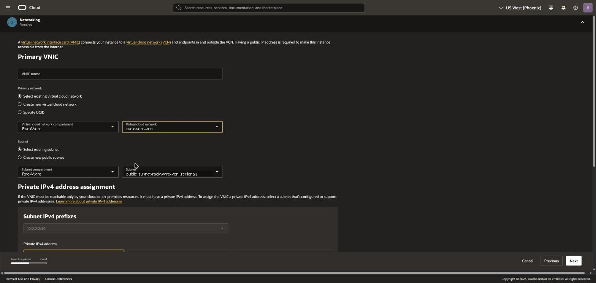

   *Figure 7 – Choose the VCN and subnet for RMM*

   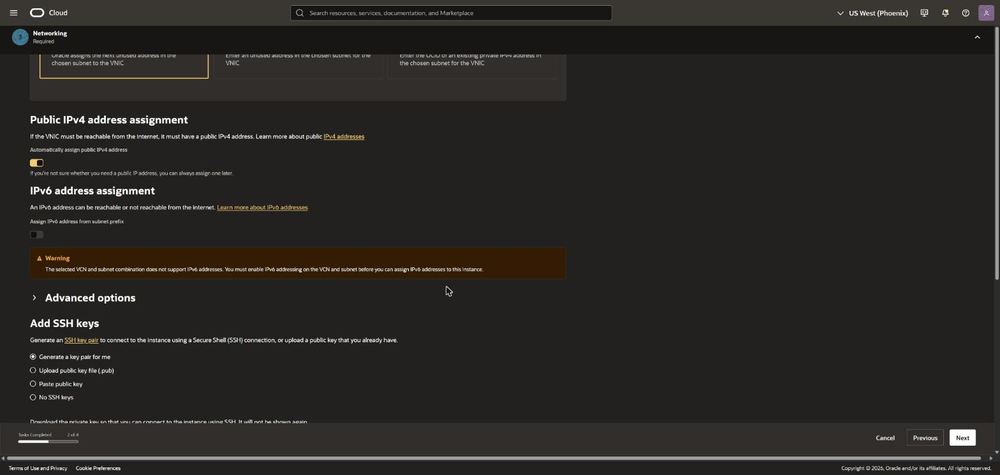

   *Figure 8 – Public IP and SSH key*


#### Step 6 – Storage

- **Migration only:** keep the default boot volume. Nothing else is needed.
- **Disaster Recovery:** click **Attach block volume → Create new volume**, size it at least as large as the used data of the servers you will protect, and choose attachment type **Paravirtualized** (the disk appears in the RMM automatically). Leave the new volume empty – you will add it to the RMM in Step 9. You can also attach it later from the instance page (Attached block volumes → Attach block volume).

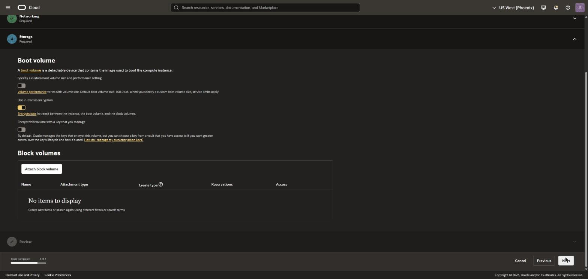

*Figure 9 – Boot volume and optional block volume for DR*


#### Step 7 – Review and create

Check the summary and click **Create**. (The Security row lists the security features available for the image; they stay off unless you enabled them in Step 4.) After 2-3 minutes the instance is **Running**. Write down its public (or private) IP address.

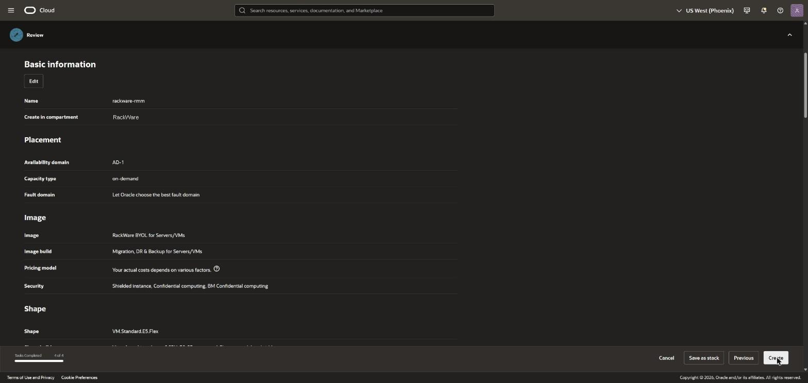

*Figure 10 – Review the settings, then click Create*

> [!WARNING]
> Open the ports from section 2.2. In the OCI Console go to Networking → Virtual cloud networks → &lt;your VCN&gt; → Security Lists → &lt;list of the RMM subnet&gt; → Add Ingress Rules: Source CIDR &lt;your IP&gt;/32, IP protocol TCP, destination port 443 (repeat for 22). Also make sure the RMM can reach the sources (22) and the target subnet (22, and 445 for Windows).


#### Step 8 – Create the web-console user (all Marketplace listings)

Connect to the RMM with SSH from your PC and run the following. All RackWare commands run as **root**. On macOS/Linux, first restrict the key file with `chmod 400 <your-private-key>`. The first time you connect, type **yes** to trust the host key.

```bash
ssh -i <your-private-key> opc@<RMM-IP>
sudo su -
useradd admin                      # if it says the user exists, just run passwd
passwd admin                       # choose the web console password
ls /root/.ssh/id_rsa.pub || ssh-keygen -t rsa -N "" -f /root/.ssh/id_rsa   # RMM key used to reach your servers
```

> [!TIP]
> The dialog in Step 2 reminds you to patch the instance. If you want to, run dnf -y update and reboot now – before requesting the license in section 5.1, because you must not reboot between rwadm relicense and applying the license.

> [!NOTE]
> Users of the web console are Linux users of the RMM: you log in to https://&lt;RMM-IP&gt; with the user and password created here.


#### Step 9 – Add the DR disk to the RMM (DR only)

If you attached a block volume for DR, add it to the RMM image pool (ZFS). Skip this step for migrations.

```bash
lsblk                               # the new, empty disk appears without partitions (e.g. sdb)
rwadm zfs configure                 # [A]dd the empty disk, then [F]inish
rw pool show                        # shows the pool size and free space
```

> [!TIP]
> **Result:** The Dashboard shows the pool size under Storage & Compute Info → ZFS pool storage (for example "1.89 GB / 398 GB" in Figure 11).


## 4. Alternative: install RMM on any Linux VM

Use this method on VMware, Nutanix, OLVM, Azure, GCP, AWS or physical hardware. RackWare (or your partner) provides the installer download link for file `rackware-v7.7.x-x86_64.sh`.

1. Create a VM with **Oracle Linux, Rocky Linux or RHEL 8.x** (minimal install), 4 vCPU, 32 GB RAM, 100-150 GB OS disk, and – for DR – an extra empty disk. Turn **Secure Boot off**.

2. Update the operating system and reboot:

   ```bash
   sudo dnf -y update && sudo reboot
   ```

3. After the reboot, install the prerequisites for the running kernel:

   ```bash
   # Rocky Linux / RHEL (and Oracle Linux when uname -r does NOT contain "uek")
   sudo dnf -y install wget tar kernel-devel-$(uname -r)
   # Oracle Linux with the UEK kernel (uname -r contains "uek")
   sudo yum -y install wget tar kernel-uek-devel-$(uname -r)
   ```

4. Download the installer, make it executable and run it as root:

   ```bash
   wget -O rackware-v7.7.x-x86_64.sh "<download link provided by RackWare>"
   chmod +x rackware-v7.7.x-x86_64.sh
   sudo ./rackware-v7.7.x-x86_64.sh
   ```

5. Answer the questions: accept the EULA; **Y** to install packages and to update firewall (iptables) rules; download the rescue ISO **only** if your target is vCenter/OCVS, OLVM, KVM or OpenShift; log retention **30** (days); GUI type **L** (the standard web console, default); set the **admin** web-console password and a **database passphrase** (store it safely).

6. At **[A]dd disks / [R]emove / [F]inished**: for DR press **A**, select the empty disk, then **F**. For migration only press **F**; the installer warns that no data disk was added and offers Abort / Try again / **Resume** – press **R** (resume).

7. Listening interfaces: press **A** (add), type `all`, then **F** (finish). Enter your **NTP** server. NAT IP: **F** (finish, no NAT). When asked "Reboot now?", answer **N**.

8. Request and apply your license (section 5.1) – do not reboot before the license is applied – then check that the services are running:

   ```bash
   sudo rwadm status all        # all services should be running
   sudo rw rmm show             # shows version, roles and license data
   ```

   > [!TIP]
   > **Result:** Opening https://&lt;RMM-IP&gt; in a browser shows the RackWare login page.


## 5. License and first login


### 5.1 Request and apply a license (BYOL and manual installs)

Skip this section only if you deployed the **Paid** listing. Use it for BYOL (including the **2 free trial licenses, valid for 30 days** – say "trial" in your email) and for manual installs. Licenses are locked to one RMM, so every new RMM needs its own license file.

1. On the RMM, as root, create the license request ("preinstall") file. A manual install creates it automatically during installation.

   ```bash
   rwadm relicense            # answer Y
   ls /etc/rackware/rwlicense_preinstall_*
   ```

2. Copy the file to your PC and send it to **licensing@rackwareinc.com** with your company name (for OCI, also your tenancy name and region):

   ```bash
   # on the RMM (replace opc with your login user on a manual install)
   cp /etc/rackware/rwlicense_preinstall_* /home/opc/ && chown opc /home/opc/rwlicense_preinstall_*
   # on your PC
   scp -i <your-private-key> opc@<RMM-IP>:rwlicense_preinstall_* .
   ```

3. RackWare replies with the license file. Copy it to the RMM the same way and apply it with `rwadm apply-license`, following the instructions in RackWare's reply (it can run while syncs are active).

4. Check the **License Details** panel on the Dashboard: status **Valid**, the license type (for example Disaster Recovery) and the remaining server count.

   > [!WARNING]
   > After running rwadm relicense, do NOT stop or reboot the RMM until the new license is applied – the old license becomes invalid at the next restart. The license also expires if the RMM stays powered off for more than 8 days.


### 5.2 Log in to the web console

1. Open **https://&lt;RMM-IP&gt;** in Chrome, Edge or Firefox. The RMM uses a self-signed certificate, so accept the browser warning.
2. Log in as **admin** with the password you set (section 3 Step 8, or the installer in section 4).

   The **Dashboard** shows everything at a glance: number of waves, hosts, images, DR policies, backup policies and failover groups; jobs in the last 24 hours; license details; RMM version; and storage, including the ZFS pool used for DR.

   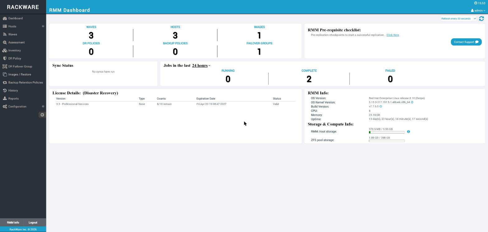

   *Figure 11 – RMM Dashboard (RMM 7.7.6.5, Disaster Recovery license, 398 GB ZFS pool)*

3. Under **RMM Pre-requisite checklist**, click **Click Here**. Go through each item (every line has a PDF with details) and tick **Yes** (or **Yes to all**). **Proceed to Add Host(s)** becomes active only when every item is ticked.

   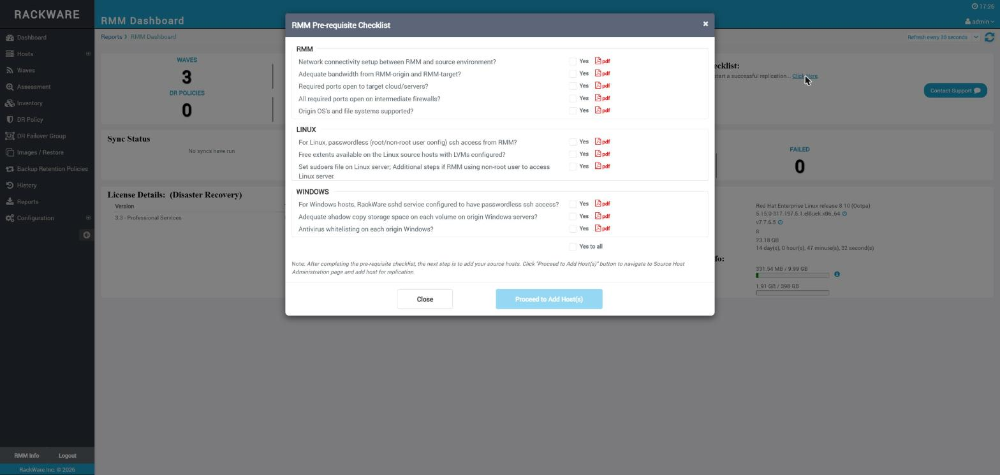

   *Figure 12 – The built-in pre-requisite checklist*

   > [!TIP]
   > If you cannot log in, check that TCP 443 is open from your PC, that the admin user exists (section 3 Step 8) and that the RMM is licensed.


## 6. Connect RMM to your cloud (Cloud User)

RMM needs permission to create the target VMs. First you give those permissions in OCI (6.1), then you enter the credentials in RMM as a **Cloud User** (6.2). You do this once per cloud account and region.


### 6.1 Prepare the OCI permissions (do this first)

Choose one authentication method:

| Method | When to use it |
|---|---|
| Instance principal (Use Metadata) | The RMM runs in OCI. Recommended: no keys to manage. Requires a tenancy with identity domains. |
| API key | The RMM runs outside OCI, or you prefer a dedicated OCI user. |


#### Option A – Instance principal

1. Copy the **OCID of the RMM instance**: Compute → Instances → rackware-rmm → Instance information → OCID → **Copy**.

2. Create a dynamic group: type **Dynamic groups** in the OCI Console search bar (Identity & Security → Domains → Default → Dynamic groups) → **Create dynamic group**. Name: **RackWareRMM**. Matching rule:

   ```bash
   ALL {instance.id = '<OCID of the RMM instance>'}
   ```

3. Create the policy: Identity & Security → **Policies** → select the **root compartment** (tenancy) → **Create policy** → Show manual editor, and paste the statements below (replace &lt;target-compartment&gt; with the compartment of the new VMs).


#### Option B – API key

1. Create (or choose) an OCI user and a group for it, e.g. **RackWareAdmins** (Identity & Security → Domains → Default → User management).

2. On the RMM (as root) create an API key and show the public key and the fingerprint:

   ```bash
   mkdir -p /root/.oci && cd /root/.oci
   openssl genrsa -out oci_api_key.pem 2048 && chmod go-rwx oci_api_key.pem
   openssl rsa -pubout -in oci_api_key.pem -out oci_api_key_public.pem
   cat oci_api_key_public.pem        # paste in OCI: your user -> API keys -> Add API key
   openssl rsa -pubout -outform DER -in oci_api_key.pem | openssl md5 -c   # fingerprint
   ```

3. In the OCI Console open the user → **API keys** → **Add API key** → Paste public key. Note the **user OCID**, the **fingerprint** and the **tenancy OCID** (Profile menu → Tenancy).

4. Create the policy in the root compartment as in Option A, writing **group RackWareAdmins** instead of dynamic-group RackWareRMM.


#### Policy statements

Minimum permissions for auto-provisioning (from the RackWare Cloud Parameters and Operations guide):

```bash
Allow dynamic-group RackWareRMM to read instance-images in compartment <target-compartment>
Allow dynamic-group RackWareRMM to manage instances in compartment <target-compartment>
Allow dynamic-group RackWareRMM to inspect vcns in compartment <target-compartment>
Allow dynamic-group RackWareRMM to use subnets in compartment <target-compartment>
Allow dynamic-group RackWareRMM to inspect private-ips in compartment <target-compartment>
Allow dynamic-group RackWareRMM to read public-ips in compartment <target-compartment>
Allow dynamic-group RackWareRMM to use vnics in compartment <target-compartment>
Allow dynamic-group RackWareRMM to inspect vnic-attachments in compartment <target-compartment>
Allow dynamic-group RackWareRMM to inspect compartments in tenancy
# Servers with more than one disk also need:
Allow dynamic-group RackWareRMM to manage volumes in compartment <target-compartment>
Allow dynamic-group RackWareRMM to manage volume-attachments in compartment <target-compartment>
```

- **Simpler alternative** (slightly broader): manage instance-family, volume-family and virtual-network-family in the target compartment, plus inspect compartments in tenancy.
- If the VCN is in a different compartment from the VMs, write the network statements (vcns, subnets, vnics, private-ips, public-ips) for the network compartment.
- If your dynamic group or group is not in the **Default** identity domain, write `dynamic-group '<domain-name>'/'RackWareRMM'`.
- Missing permissions show up later as an autoprovision error such as "Authorization failed or requested resource not found".


### 6.2 Add the Cloud User in RMM

1. In the left menu go to **Configuration → Cloud Users** (the page title is "Cloud User") and click **Add Cloud User**.
2. Enter a **Name** and select the **Provider** (OCI in this example). The form shows the fields for that cloud.

   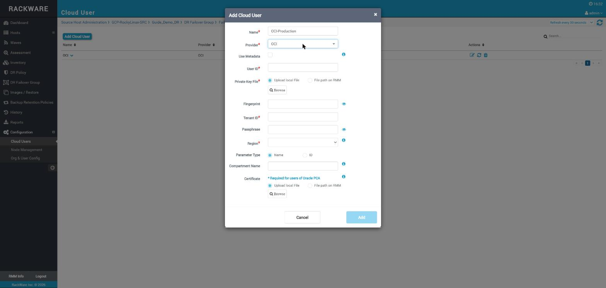

   *Figure 13 – Add Cloud User – OCI fields*

   | Field | What to enter (OCI) |
   |---|---|
   | Use Metadata | Tick for Option A (instance principal). User ID, key, fingerprint and Region are then greyed out; only Tenant ID is needed. |
   | User ID | Option B: the OCID of the OCI user. |
   | Private Key File | Option B: choose **File path on RMM** and enter `/root/.oci/oci_api_key.pem`. |
   | Fingerprint | Option B: required for API keys, even though the form does not mark it with an asterisk. |
   | Tenant ID | The tenancy OCID (Profile menu → Tenancy). Required for both options. |
   | Passphrase | Only if your private key is encrypted. Leave empty for the key generated in Option B. |
   | Region | Option B: region where target VMs are created, e.g. us-phoenix-1, sa-saopaulo-1, sa-santiago-1, mx-queretaro-1. |
   | Parameter Type | **Name** = you type names (the compartment here; VCN and subnet later in Autoprovision Config, section 8.3). **ID** = you paste OCIDs. |
   | Compartment Name | Default compartment for the target VMs (leave empty for root). |
   | Certificate | Only for Oracle Private Cloud Appliance (PCA). |

   Click **Add**. After a few seconds the cloud user shows the state **Ready**.

   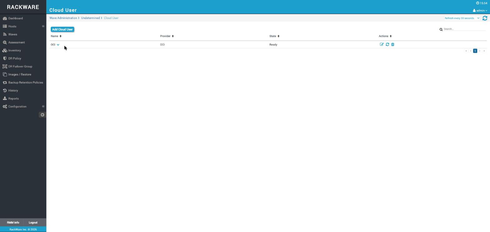

   *Figure 14 – The cloud user is Ready*

   > [!TIP]
   > Other clouds work the same way. The Provider menu lists AWS, Azure, Digital Ocean, Google, Huawei, IBM Cloud VPC, KVM, Linode, OCI, OLVM, OpenShift, vCenter, Zadara and others, each with its own fields.


## 7. Prepare your source servers


### 7.1 Linux servers

1. On the source, create a user for RackWare (or use an existing sudo user):

   ```bash
   sudo useradd -m -s /bin/bash rackware
   ```

2. Give it the sudo rights RMM needs. On the RMM, display the required text:

   ```bash
   cat /opt/rackware/docs/sudo-config.txt
   ```

   On the source, run `sudo visudo` and paste that text at the end of the file. If your user is not called rackware, replace the user name in the pasted text. Check the result with `sudo -l -U rackware` (it lists the allowed commands).

3. Copy the RMM public key to the source. On the RMM, show the key (if the file does not exist, create it with the ssh-keygen command from section 3 Step 8):

   ```bash
   cat /root/.ssh/id_rsa.pub        # copy the whole line
   ```

   On the source, paste it into the user's authorized_keys file:

   ```bash
   sudo -u rackware mkdir -p /home/rackware/.ssh
   sudo -u rackware vi /home/rackware/.ssh/authorized_keys   # paste the key line, save
   sudo chmod 700 /home/rackware/.ssh && sudo chmod 600 /home/rackware/.ssh/authorized_keys
   sudo restorecon -Rv /home/rackware/.ssh                  # only if SELinux is enabled
   ```

4. Allow TCP 22 from the RMM IP in the source's cloud firewall (section 2.2) and, if firewalld is active on the source, in the OS firewall:

   ```bash
   sudo firewall-cmd --permanent --add-rich-rule='rule family=ipv4 source address=<RMM-IP>/32 port port=22 protocol=tcp accept'
   sudo firewall-cmd --reload
   ```

5. Test from the RMM. The first time, type **yes** to trust the host key; after that the command must print OK **without asking for a password**:

   ```bash
   ssh rackware@<source-IP> "sudo -n true && echo OK"
   ```

   - Keep **15-20% free space in each LVM volume group** – RMM uses LVM snapshots to copy a consistent server.
   - Make sure `/tmp` and `/var/tmp` are **not** mounted with `noexec`.
   - Exclude `/mnt/rackware` from antivirus scanning.


### 7.2 Windows servers

1. Open TCP port 22 on all firewall profiles (elevated PowerShell), and allow TCP 22 from the RMM IP in the cloud firewall:

   ```bash
   netsh advfirewall firewall add rule name=rw-tcp22-in dir=in action=allow protocol=TCP localport=22 profile=any
   ```

2. Get the RackWare SSH service installer from **https://&lt;RMM-IP&gt;/windows/RWSSHDService_x64.msi** (accept the certificate warning). If the server's browser blocks the download, download it on your PC and copy it to the server.

3. On the RMM, run `cat /root/.ssh/id_rsa.pub` and copy the whole line.

4. Run the MSI as administrator. Paste the key into the **RMM SSH Key** field, leave the user as **SYSTEM** and the password blank, port **22**.

5. Test from the RMM: `ssh SYSTEM@<windows-IP>`. Type **yes** to trust the host key; you should get a command prompt from the Windows server without a password.

   - Keep at least **1 GB free on C:** and about **15% free** on each volume for VSS snapshots.
   - Add antivirus exclusions for the RackWare processes (rsync.exe, rwattr.exe, rwchangesvc.exe) and folders (C:\Program Files\Rackware-winutil, C:\Windows\Temp\Rackware-winutil).
   - The default system language should be English. Non-English Windows is supported with an extra step – ask RackWare Support.
   - When you add a Windows server in RMM (section 8.1), leave **Username** empty: it defaults to SYSTEM.


## 8. Migrate your first server

The migration has five parts: **add the host → check the target settings → create a wave → press Start → verify**. In our test, a Rocky Linux 9 server in Google Cloud (3.6 GB used) was migrated to a brand-new OCI instance in **7 minutes 38 seconds**.


### 8.1 Add the source server

1. Go to **Hosts → Source**. Click **Add Host → Add Specific Host** (or **Add Hosts in Bulk** to import many servers from a CSV template).

   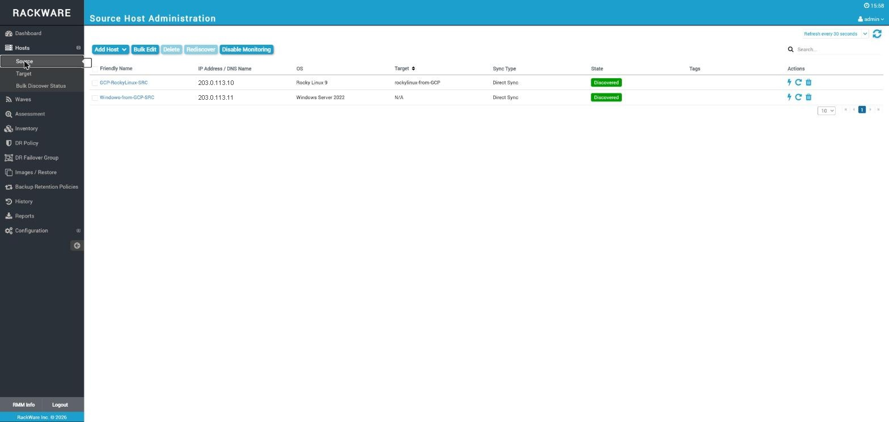

   *Figure 15 – Hosts → Source lists your servers (two already added in this lab)*

2. Fill in the **source** details: **Friendly Name** (any name without spaces), **IP Address** (or DNS name), **Operating System**, **SSH Port** (type 22) and **Username** (the user from section 7.1; leave empty for Windows).

3. In **Target Config**, open **Target Options** (default: "Do not set target host now") and choose how the target is created:

   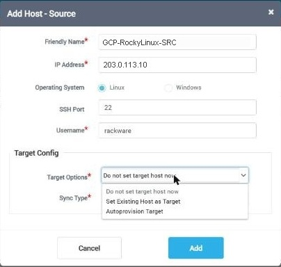

   *Figure 16 – Target Options*

   | Target option | When to use it |
   |---|---|
   | Do not set target host now | You only want to discover / assess the server first. |
   | Set Existing Host as Target | You created the target VM yourself (e.g. VMware without API access, or a DR standby). It must first be registered under Hosts → Target (section 8.2). |
   | Autoprovision Target | Recommended. RMM creates the target VM in the cloud for you, sized like the source. |

4. For **Autoprovision Target**, complete the fields, **always select a Sync Type**, and click **Add**:

   | Field | What to choose |
   |---|---|
   | Cloud User | The cloud user from section 6. |
   | Target Friendly Name | Name of the new VM (optional – RMM generates one if empty). It must not be the name of an existing target. |
   | Provisioning Type | **Pre-Provisioning:** the target VM is created at the first sync (when you start the wave) and then kept – use it for migrations and for "hot" DR. **Dynamic Provisioning:** the VM is created only at failover – lowest-cost DR. **Fast Dynamic Provisioning** (may appear only after a node is set up under Configuration → Node Management): like dynamic, with images kept on a cloud node – ask RackWare. |
   | Sync Type | **Direct Sync** for a migration. **Stage 1 and Stage 2** for DR. The choices change with the Provisioning Type (Dynamic allows only Stage 1). |

   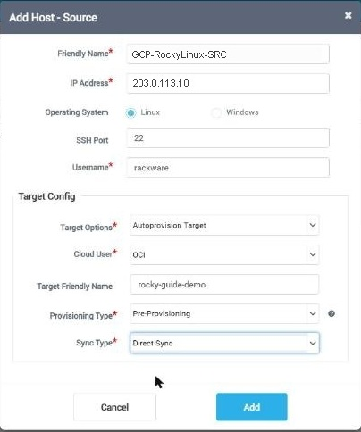

   *Figure 17 – Source host with an auto-provisioned OCI target, Pre-Provisioning and Direct Sync*

   RMM connects to the server and discovers it (about 30 seconds). Nothing is created in the cloud yet. Close the dialog: in Hosts → Source the **State** column shows green **Discovered**. If it shows an error, see section 10.

   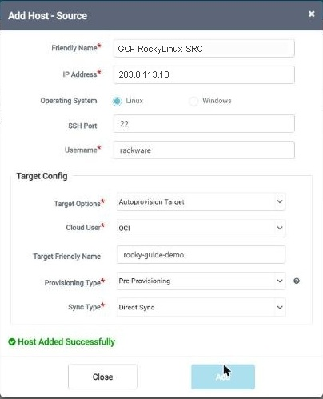

   *Figure 18 – Host Added Successfully*

   > [!WARNING]
   > RMM identifies a source server by its IP address. Adding a server whose IP is already registered updates the existing host (name and settings) instead of creating a new one.


### 8.2 Optional: use an existing VM as the target

Only needed when you choose **Set Existing Host as Target**. Prepare the VM for SSH exactly like a Linux or Windows source (section 7), then go to **Hosts → Target → Add Host → Add Specific Host**, enter its name, IP, OS, SSH port and user, and click **Add**. It then appears in the **Target Host** list of the source host. (VMs that RMM auto-provisioned are listed under Hosts → Target automatically.)

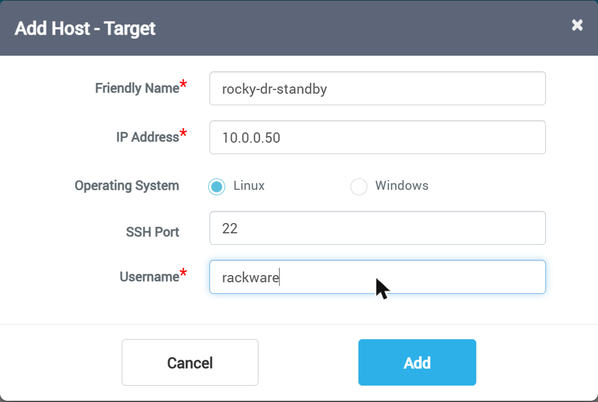

*Figure 19 – Register an existing VM under Hosts → Target*


### 8.3 Check the host and its target settings

Click the host name to open **Host Details**. You see the discovered hardware, disks, file systems, network and the target configuration. **Edit** (General Info) lets you change the target and sync type later.

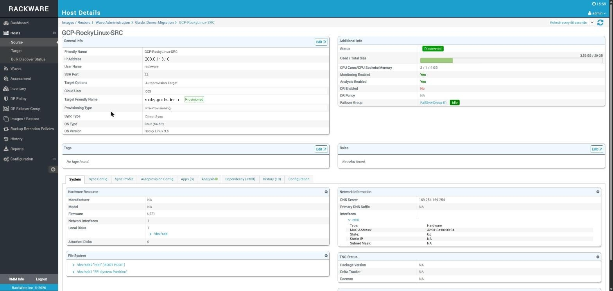

*Figure 20 – Host Details: status Discovered, used/total size, CPU and memory*

For Autoprovision hosts, open the **Autoprovision Config** tab (it exists only for Autoprovision hosts) and click **Edit**. Fill in the required fields (red asterisk) **before you start the wave**:

| Field | Meaning |
|---|---|
| Region, AV Domain (required) | Where the new VM is created. Fault Domain is optional. |
| Resource Parameter Type | NAME = choose resources by name. ID = paste OCIDs. |
| VCN Name, Subnet Name (required) | For each one, first choose the compartment that contains it, then the name. |
| Compartment Name | Optional: compartment of the new VM. Empty = the cloud user's compartment. |
| Shape / OCPUs / Memory | Leave empty to let RMM choose the shape closest to the source, or set your own. |
| Use Private IP / Private IP | Yes = give the new VM a fixed private IP that you enter. |
| No Public IP | No (default) = the new VM gets a public IP. Yes = private IP only. |
| Storage Vault/Key, Provision Disks, NSG, Image Name, Dedicated Host, Capacity Reservation | Optional advanced settings. |

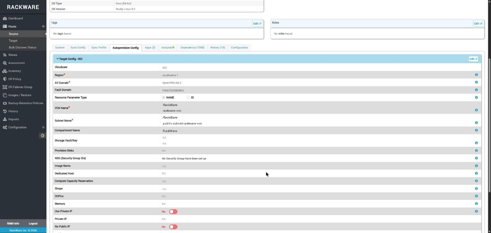

*Figure 21 – Autoprovision Config for OCI*


### 8.4 Create a wave

1. Go to **Waves** and click **Add Wave**. (Your list may already contain other waves – ignore them.)
2. Type a **Wave Name**, tick the server(s) to include and click **Add**.

   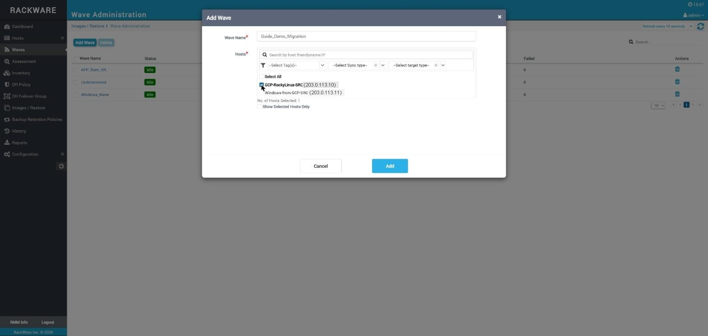

   *Figure 22 – Add Wave – select the hosts to migrate together*

   > [!TIP]
   > Group servers that must move together (for example, all tiers of one application) in the same wave. The Parallel Count dropdown at the top of the wave page limits how many servers sync at once.


### 8.5 Start the migration

The wave page uses icon buttons (hover over an icon to see its name):

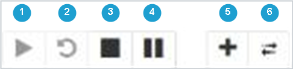

*Figure 23 – Wave toolbar*

| # | Button (tooltip) |
|---|---|
| 1 | Start Replications – starts the sync of the selected hosts |
| 2 | Restart Replications |
| 3 | Stop Replications |
| 4 | Pause Replications |
| 5 | Add Host – add host(s) to the wave |
| 6 | Move machine(s) – move host(s) to another wave |

1. Open the wave, tick the host(s) and click **Start Replications** (button 1). Confirm with **Start**.

   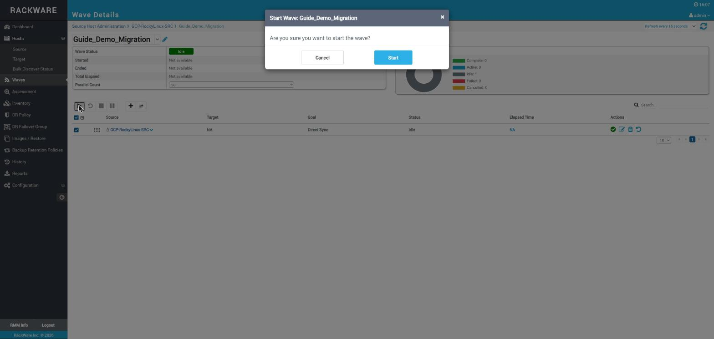

   *Figure 24 – Start the wave*

   Follow the progress in the **Status** column. RMM first creates the VM in the cloud (**Autoprovision**), then copies the data (**Sync Data**).

   

   *Figure 25 – Status: Autoprovision – RMM is creating the OCI instance*

   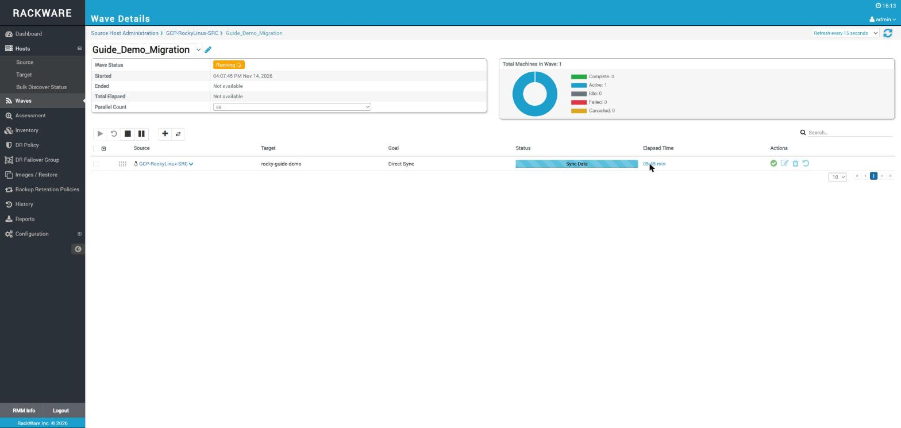

   *Figure 26 – Status: Sync Data – the target exists and data is being copied*

   When the host shows **Successful**, the target VM is a running copy of the source.

   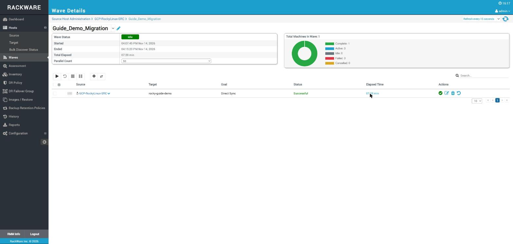

   *Figure 27 – Migration finished: Successful in 07:38 min*

   > [!TIP]
   > **Result:** The status is Successful and the wave chart is green. The new VM appears in your cloud console.


### 8.6 Verify in the cloud and plan the cutover

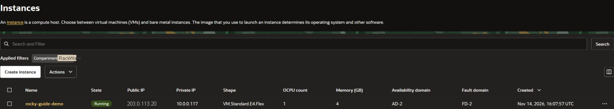

*Figure 28 – The migrated server running in OCI*

- **Logging in:** the target is a copy of the source, so use the **same users, passwords and SSH keys as on the source**. The hostname is the same; the IP address comes from the target subnet.
- **Testing:** test the application on the target. Remember that every new sync **overwrites the target**, so changes made on it during testing are lost.

When you are ready for the final switch:

1. Shortly before the cutover window, open the wave and click **Start Replications** again – only changes are copied, so it is fast.
2. Stop the applications on the source (to freeze the data) and start the wave one last time.
3. Shut down the source, update DNS / load balancers to point to the new server and run your tests.
4. Keep the source powered off (not deleted) for a few days as a rollback option.

   > [!NOTE]
   > Operating system and application licenses (for example Windows activation) are the customer's responsibility after moving to a new platform.


## 9. Protect a server with Disaster Recovery


### 9.1 How DR works

- **Stage 1** copies the source to an **image** stored in the RMM ZFS pool (the DR disk). It runs on a schedule – every 5-120 minutes, every 1-24 hours, daily/weekly, or continuously. The interval is your **RPO** (how much data you could lose).
- **Stage 2** copies the image to the **standby target** in the DR site/cloud.
- At **failover** the standby target is brought up with the latest data. RTO is typically **15-30 minutes** with a pre-provisioned standby and longer when the VM is created only at failover (lower cost).
- The RMM pulls data over SSH and accepts no inbound connections from protected servers, and images can be restored to an earlier point – useful against ransomware.

| Standby model | RTO | Cost | How to configure the host |
|---|---|---|---|
| Pre-provisioned (hot/warm) | Lowest | Standby VM always exists | Sync Type Stage 1 and Stage 2; target = Autoprovision with Pre-Provisioning, or an existing VM |
| Dynamic provisioning (cold) | Higher | No VM until failover | Autoprovision with Dynamic Provisioning; Sync Type Stage 1 only |
| Fast Dynamic provisioning | Medium | Images on a cloud node | Fast Dynamic Provisioning (needs Node Management; ask RackWare) |


### 9.2 Prepare the host for DR

1. Check that the RMM has a ZFS pool large enough for the servers you protect: Dashboard → **ZFS pool storage** (or `rw pool show`). If there is none, add the DR disk (section 3 Step 6 and Step 9, or the installer in section 4).

2. Choose the standby target for the host:

   - **New standby (recommended):** Target Options = **Autoprovision Target**, Provisioning Type = **Pre-Provisioning**, a **new** Target Friendly Name, and the DR region/subnet in Autoprovision Config.
   - **Existing standby VM:** choose **Set Existing Host as Target** and select it in **Target Host**. Any VM listed under Hosts → Target can be used – one you registered (section 8.2) or one RMM auto-provisioned earlier.

3. Open the host, click **Edit** in General Info, set **Sync Type = Stage 1 and Stage 2** and the target from step 2, and click **Save**.

   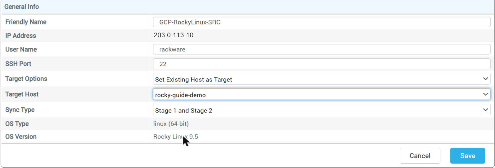

   *Figure 29 – Host configured for DR (here with an existing standby target)*

   > [!NOTE]
   > To keep this guide short, our example reuses the OCI VM created in section 8 (rocky-guide-demo) as the standby. In a real project the standby is a separate VM in the DR region.

   > [!TIP]
   > If the host keeps Autoprovision with a Target Friendly Name that already exists, Stage 2 fails with RSP_FRIENDLYNAME_EXISTS. Use a new name, or Set Existing Host as Target.


### 9.3 Create a DR policy

1. Go to **DR Policy** and click **Create Policy**.

2. On **Policy Configuration**, fill in:

   | Field | Meaning |
   |---|---|
   | Policy Name | Any name, e.g. ERP-DR. |
   | Parallel Sync Count | How many hosts of the policy sync at the same time (default 1; 0 = no limit). |
   | Policy Start Time | Optional. Empty = the policy can start as soon as it is turned On. |
   | Schedule Name | Name of this schedule, e.g. Every_1_Hour. |
   | Periodicity | By Schedule (daily/weekly at a time), By Frequency, Once or Continuous. |
   | Repeat Unit / Interval | By Frequency only: Minutes (5-120) or Hours (1-24), and how often. |
   | Exclude From / To | By Frequency only, optional: a blackout window (e.g. business hours) when no sync starts. |
   | Sync Profile | Optional. Leave empty to use the host's default sync settings. |

3. Click **Next**. On **Notification Settings** (optional) choose "Only When Sync fail" or "When Sync succeed or fail", type an **Email Subject**, type the address and click **+Add**. (The RMM must be able to send email – ask RackWare Support if notifications do not arrive.) Click **Next**.

4. Check the summary on **Confirmation** and click **Create**.

   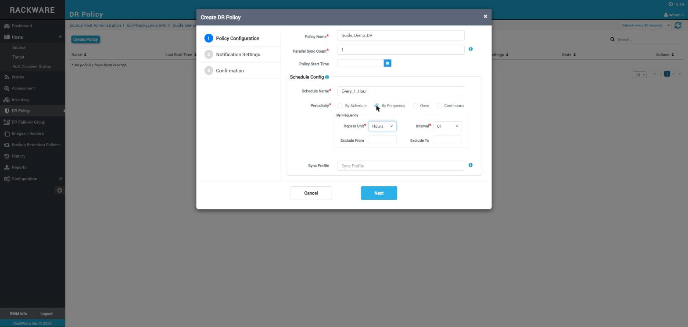

   *Figure 30 – Policy configuration – sync every 1 hour*

   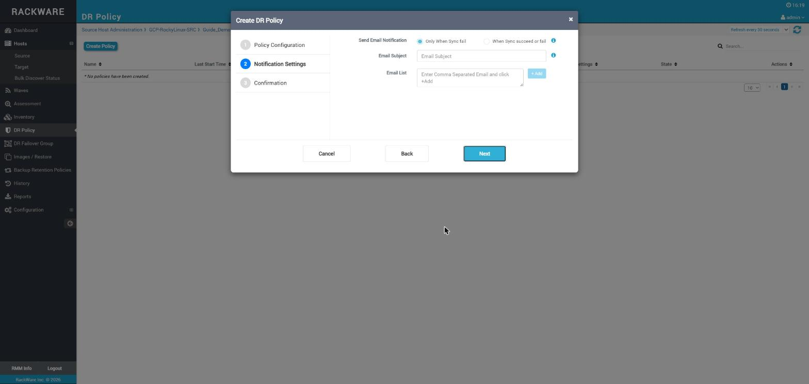

   *Figure 31 – Notification settings*

   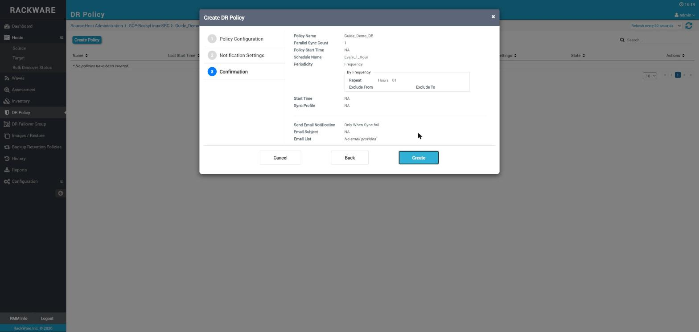

   *Figure 32 – Confirmation*

   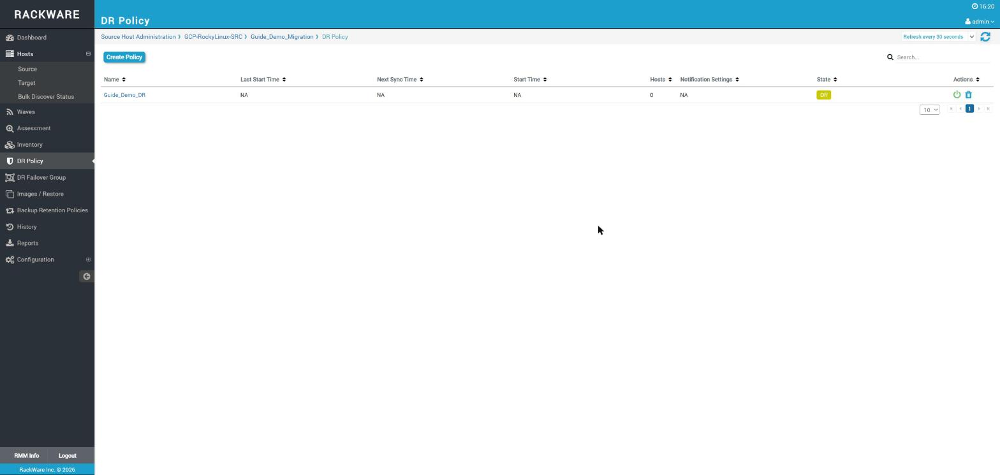

   *Figure 33 – The new policy (still Off and without hosts)*


### 9.4 Add hosts to the policy and run the first sync

Click the policy name to open it. The page has three tabs – **Applied Host(s)**, **Schedule(s)** and **Notification Settings** – and three icon buttons:

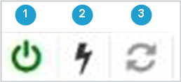

*Figure 34 – DR policy toolbar*

| # | Button |
|---|---|
| 1 | Policy On / Off – turns the schedule on or off |
| 2 | Sync policy to schedule immediately (lightning icon) |
| 3 | Retry failed syncs |

1. On **Applied Host(s)** click **Add Host → Add Specific Host**, tick the server(s) and click **Apply**.

   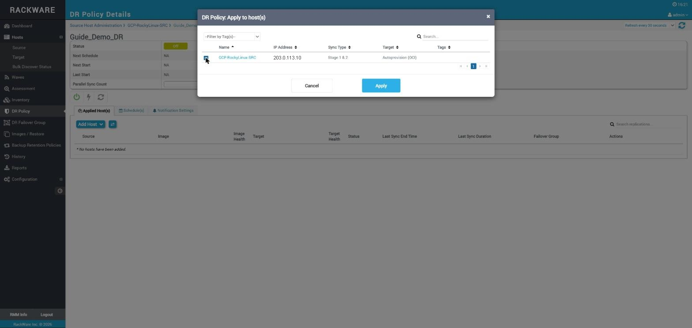

   *Figure 35 – Apply the DR policy to the host*

   If the list is empty and shows the message below, the host is not set to a Stage 1 sync type – go back to section 9.2 step 3.

   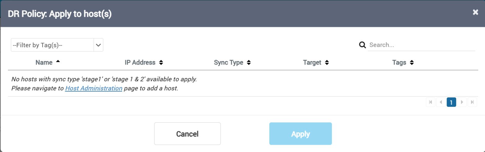

   *Figure 36 – Message shown when no host has a Stage 1 sync type*

2. Click the **lightning** button (2). Choose **Sync entire policy** (all hosts) or **Sync only selected hosts**, pick the schedule, optionally change Parallel Sync Count, and click **Sync Now** to run the first replication right away.

   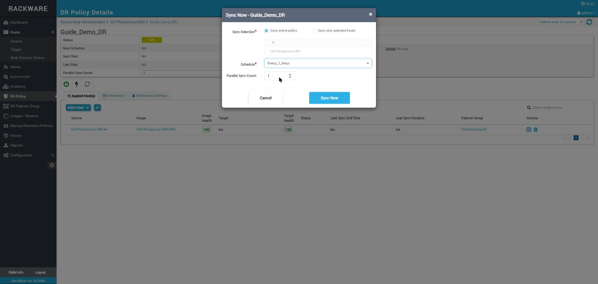

   *Figure 37 – Run the first DR sync immediately*

   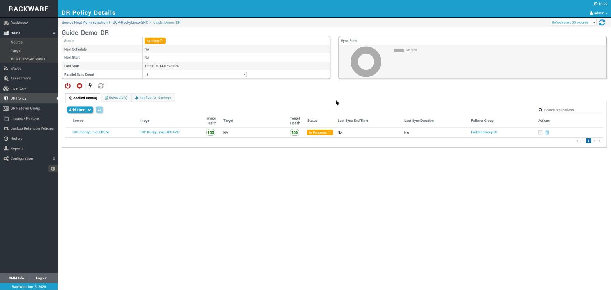

   *Figure 38 – DR sync in progress*

   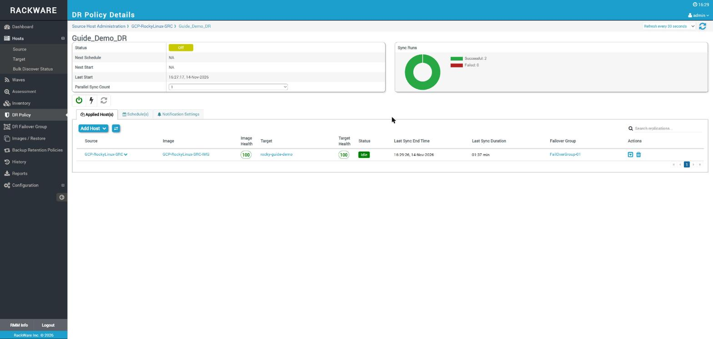

   *Figure 39 – First DR sync finished: 2 successful runs (Stage 1 and Stage 2), status Idle*

   > [!TIP]
   > **Result:** Image Health and Target Health show 100 and the Sync Runs chart is green.

3. Click **Policy On / Off** (button 1) to turn the policy **On**. From now on RMM syncs automatically according to the schedule.

   > [!TIP]
   > If a sync fails, click the small (i) icon next to Failed to see the exact error and the job log file.


### 9.5 Create a failover group

Failover is run from **DR Failover Group**. A failover group contains the hosts that must recover together, each with a **Tier** (boot order): for example databases in tier 0, application servers in tier 1, web servers in tier 2. Each host belongs to one group only.

1. Go to **DR Failover Group** and click **Add Failover Group**.
2. Enter a **Failover Group Name** and keep **Host(s) added to DR Policy** (the other options let you add hosts not yet protected, or load a CSV). Tick the hosts and set their **Tier**. Keep Failover / Fallback Profile = default. Click **Add**.
3. To change a tier later, click the edit icon of the host (**Modify Host Configuration**). **Boot Delay** adds a wait (minutes or hours) after that host boots; leave 0 unless an application needs time to start.

   > [!NOTE]
   > If the list says "No spare hosts from any DR Policy are available to add", the host is not in a DR policy yet (section 9.4) or already belongs to another failover group. Do not click Add with an empty list.

   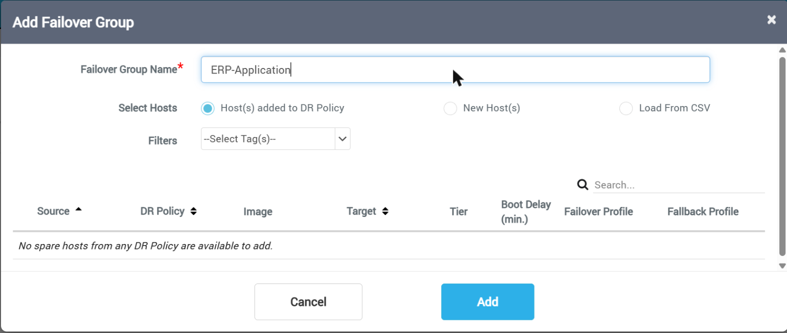

   *Figure 40 – Add Failover Group*

   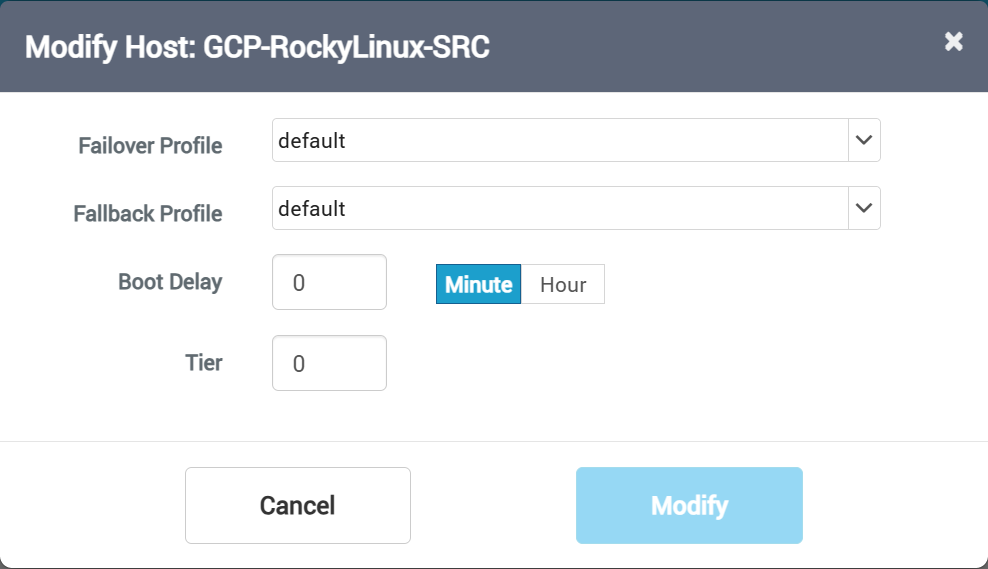

   *Figure 41 – Modify Host Configuration: Tier and Boot Delay*

   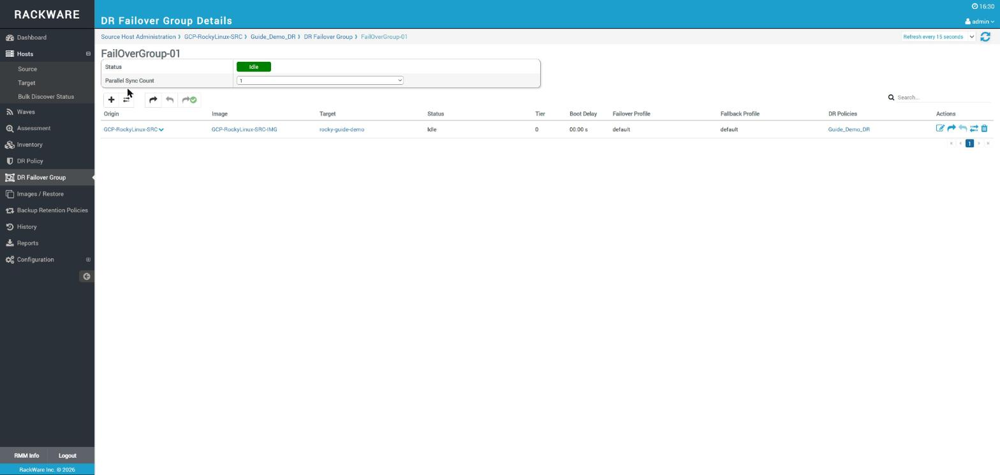

   *Figure 42 – A failover group with one host: image, target, tier and DR policy*

   The failover group page uses icon buttons (it also has a Parallel Sync Count for failover operations):

   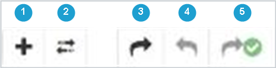

   *Figure 43 – Failover group toolbar*

   | # | Button |
   |---|---|
   | 1 | Add Host(s) to the group |
   | 2 | Move Host(s) to another group |
   | 3 | Failover |
   | 4 | Fallback |
   | 5 | Complete Failover |

   Each host row also has icons to modify, fail over, fall back, move or remove only that host.


### 9.6 Test your DR (non-disruptive)

1. Turn the DR policy **Off** (or check that no sync is running). Failover fails while a Stage 1 sync is running.
2. Make sure the DR network is **isolated** from production (no route between them except through the RMM), so the test copy cannot conflict with the production server (same hostname, Active Directory, etc.).
3. Open the failover group and click **Failover** (button 3).
4. Choose **Entire group** (or Selected hosts), leave **Override Boot Order** unticked (it ignores the tiers), tick **Test Mode** and click **Failover**.

   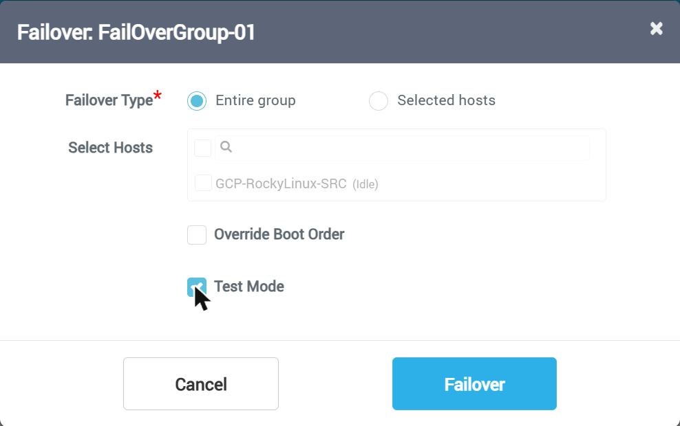

   *Figure 44 – Failover with Test Mode enabled*

   The production server keeps running. The standby target is brought up with the latest replicated data so you can log in and validate the application. Changes you make on it during the test are overwritten by the next Stage 2 sync.

   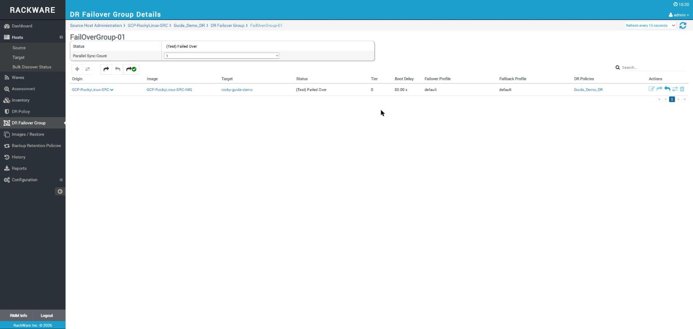

   *Figure 45 – Status: (Test) Failed Over*

5. When you finish validating, click **Complete Failover** (button 5) and confirm. This ends the test and returns the group to **Idle**. Do not use the Fallback buttons after a test.
6. Turn the DR policy back **On**.

   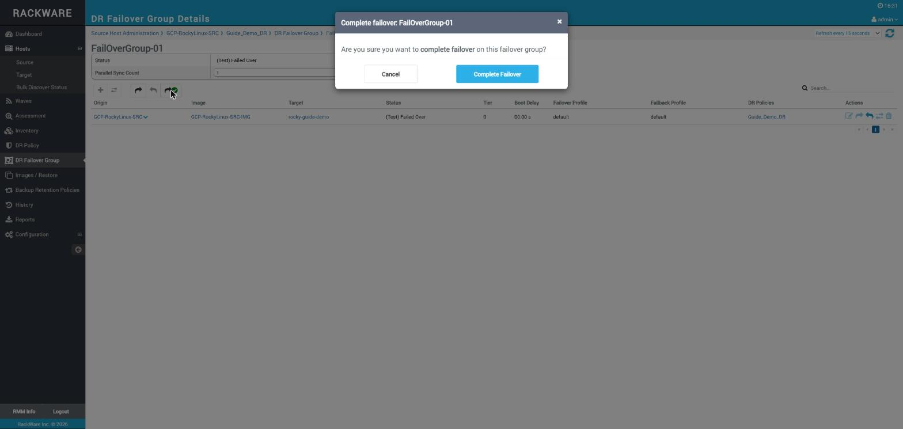

   *Figure 46 – End the test with Complete Failover*

   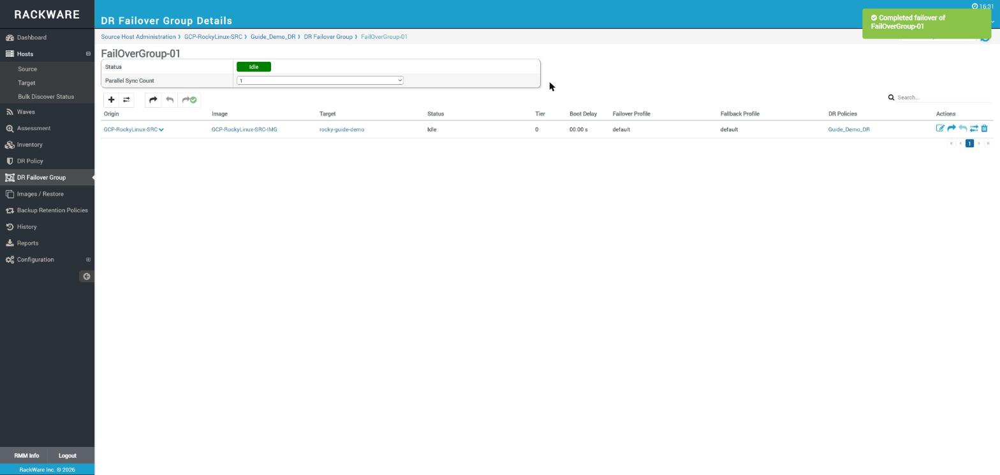

   *Figure 47 – Test finished – the group is Idle again*

   > [!WARNING]
   > Complete Failover means two different things: after a TEST failover it simply ends the test (safe). After a REAL failover it makes the DR site permanent and fallback is no longer possible. Fallback is not supported after a Test Mode failover.


### 9.7 In a real disaster: failover and fallback

1. Turn the DR policy **Off** so no Stage 1 sync is running.
2. In the failover group click **Failover** **without** Test Mode. RMM runs a final Stage 2 and brings the hosts up tier by tier. A reverse Stage 1 starts automatically to protect the servers now running in DR (it uses the same ZFS pool, so keep free space).
3. Update DNS / networking so users reach the DR site.
4. When the original site is back – servers running and reachable from the RMM on TCP 22 (445 for Windows) – click **Fallback**: RMM copies the changes back (reverse Stage 1 and Stage 2) and brings the original servers up.
5. Point DNS back to the original site and turn the DR policy **On** again.

   > [!WARNING]
   > After a real failover, only click Complete Failover if you will never fall back to the original site.


### 9.8 Stop protecting a server / clean up

Remove objects in this order (each step uses the trash icon of the object):

1. **DR Failover Group:** remove the host from its group (row icon Remove Host).
2. **DR Policy:** open the policy and remove the host from Applied Host(s). Delete the policy when it has no hosts.
3. **Waves:** delete waves you no longer need (deleting a wave does not delete its hosts).
4. **Hosts → Target:** delete targets you no longer need. The dialog offers **Delete VM**; afterwards check in the cloud console that the VM is really gone and terminate it there if needed.
5. **Hosts → Source:** delete the source host if you will not sync it again.

   > [!NOTE]
   > Ask RackWare whether removing a host returns its license count to your pool.


## 10. Troubleshooting and quick answers

| Symptom | What to check |
|---|---|
| Cannot open or log in to the web console | TCP 443 open from your PC? Admin user created (section 3 Step 8)? RMM licensed? |
| Host discovery fails / asks for password (Linux) | Run ssh rackware@&lt;source-IP&gt; "sudo -n true && echo OK" on the RMM. Check authorized_keys permissions (700/600), SELinux context (restorecon), the sudoers text and the firewalls. |
| Host discovery fails (Windows) | Port 22 open on all firewall profiles and in the cloud firewall? RWSSHD installed with the RMM key? Antivirus blocking RackWare tools? |
| Sync error mentioning examine / deploy, or "noexec" | /tmp or /var/tmp mounted with noexec. Remove noexec, or ask Support to configure an alternative temp directory. |
| Snapshot / LVM error | Not enough free space in the volume group. Add a disk and extend the VG (15-20% free). |
| Autoprovision fails ("Authorization failed or requested resource not found") | Cloud User state Ready? OCI policy statements (section 6.1)? Required fields in Autoprovision Config? Cloud service limits for the shape? |
| Stage 1 fails with a storage error | ZFS pool missing or full (Stage 1 needs at least 5% free). Add a disk with rwadm zfs configure. |
| RSP_FRIENDLYNAME_EXISTS | A target with that name already exists. Choose another Target Friendly Name, or use Set Existing Host as Target. |
| Failover fails | A Stage 1 sync was running. Turn the DR policy Off, wait for the sync to end and retry. |
| No new syncs after 30 days of a trial | The BYOL trial licenses are valid for 30 days. Request a license (section 5.1). |
| License stopped working after restart | rwadm relicense was run and the RMM restarted before the new license was applied. Contact licensing@rackwareinc.com. |


### Where to find more information

- **History** (left menu): every operation with its status and Job ID. Use **Export To CSV** or **Generate Report**. Log files are under `/var/log/rackware/` on the RMM.
- **Reports:** DR Summary Report (Auto Generated / User Generated).
- Documents linked from the OCI Marketplace listing: RMM Planning - Deployment - Prerequisite Guide; GUI Operations Guide; RackWare Disaster Recovery; Getting Started for Oracle Marketplace (BYOL).
- The RMM Cloud Parameters and Operations guide (all cloud parameters and permissions) is available from RackWare Support.
- RackWare Support: **support@rackwareinc.com**, +1 844 797 8776, or the **Contact Support** button on the Dashboard.
- All commands of this guide are also available as plain text in the file RackWare_RMM_Guide_Commands.txt delivered with this guide (for copy and paste).


## Appendix – One-page checklist

| # | Task | Done |
|---|---|---|
| 1 | RMM VM created (4 OCPU / 32 GB recommended, Secure Boot off) – Marketplace or manual install |  |
| 2 | Ports open in OS and cloud firewalls: 443/22 to RMM; 22 RMM → sources; 22/445 RMM → targets; 443 RMM → cloud API |  |
| 3 | Web console user created (Marketplace) and license active (Paid, trial or license file applied) |  |
| 4 | Logged in to https://&lt;RMM-IP&gt;; pre-requisite checklist reviewed |  |
| 5 | OCI permissions created (dynamic group + policy, or API key + group + policy) and Cloud User Ready |  |
| 6 | Sources prepared (Linux: user + sudo + key; Windows: RWSSHD) and SSH tested from RMM |  |
| 7 | Host added and Discovered; Autoprovision Config required fields filled |  |
| 8 | Wave created and run – status Successful; target validated; cutover planned |  |
| 9 | DR: block volume attached and added with rwadm zfs configure; host set to Stage 1 and Stage 2 with a standby target; DR policy created; first sync OK; policy On |  |
| 10 | DR: failover group created and a Test Mode failover completed |  |

